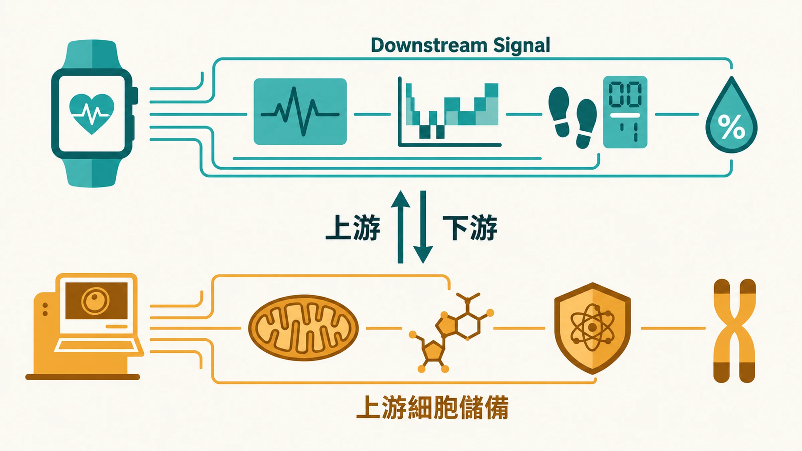

你有沒有過這種早晨：

App 告訴你昨晚睡了 7 小時，睡眠品質「良好」，但你起床的感覺，完全不是這樣。

或者相反：HRV 數字好看，恢復分數 85，但你整個下午依然腦霧、提不起勁。

這不是裝置壞了，也不是你對數字過度解讀。

這是穿戴裝置本身的設計邊界。

---

## 穿戴裝置在測什麼？

現今的穿戴裝置，早就不是 2011 年底當時只有加速度感測器的計步器了。

2012 年底，利用光電容積脈搏波描記法（Photoplethysmography，PPG）的技術，第一次量產可連續量測心率後，到現在已經是配備 AI 的穿戴裝置。

Oura Ring 在 2025 年推出「累積壓力指標」，整合體溫變化、HRV 連續性、睡眠結構，追蹤你的身體在一個月維度上的壓力累積與清除狀態。

Apple Watch 在 2025 年 9 月取得美國 FDA 許可（510(k)），可以偵測高血壓發展趨勢（適用 Series 9 以上機型），開發數據來自超過 10 萬名受試者的驗證研究，這個功能目前仍在各地區陸續推出中。

Whoop 5.0 加入了「Healthspan」指標，把日常的訓練與睡眠決策連結到老化速度的追蹤。

這些裝置在測的，主要是三類數據：

**心率變異（Heart Rate Variability，HRV）：** 心跳與心跳之間的時間間隔變化，反映自律神經系統的調節能力。

心理承受壓力時，交感神經活性會顯著增加、副交感神經活性會顯著下降。

HRV 越高，代表你的身體在「副交感模式」，也就是恢復、修復的狀態。

HRV 持續偏低，是身體承受慢性壓力的訊號。

**睡眠結構：** 透過加速度感測器、光學感測器、揚聲器/ 麥克風等元件記錄設備整晚的位移變化、光強度變化、聲音變化訊息，來追蹤深眠比例、REM 時長、睡眠效率。

在獨立驗證研究中，這類裝置判斷「睡著還是醒著」和睡眠多項生理檢查（Polysomnography，PSG）的吻合率大約在 86–89%；但要分辨深眠、淺眠、REM 這些睡眠階段，準確度明顯較低。

用來看總睡眠時間和長期趨勢沒問題，睡眠階段的數字參考就好。

**最大攝氧量（VO2 Max）與恢復分數：** 最大攝氧量是心肺適能的代理指標，也是目前預測全因死亡率最強的單一測量值之一。

Whoop 的「應變分數」和 Oura 的「就緒分數」都在嘗試把這些整合成一個可以行動的日常決策依據。

這些數字是真實的。測量方法是有科學支持的。

但它們都有一個共同的限制。

---

## 這些數字在說「結果」，不是「原因」

HRV 下降了。

這個數字告訴你：你的自律神經系統調節能力變差了，身體沒有從昨天的壓力中充分恢復。

但它不告訴你為什麼。

是昨晚睡前喝了酒？是連續三週的工作壓力？是慢性低度發炎在消耗你的恢復資源？是粒線體產能效率下降？

裝置給你的是游泳池水位的警告，不是哪裡在漏水的診斷。

這個區別非常重要，因為如果你不知道原因，你只能靠感覺去猜要怎麼介入。

早睡一小時？減少訓練量？補充鎂？還是整個生活方式都需要重新調整？

穿戴裝置讓「感覺」變成了「數字」。這是進步。

但數字背後的機制，它看不見。

---

## 在 HRV 開始下降之前，細胞層面早就發生了事

這是時間軸的問題。

慢性發炎和氧化壓力的累積，是一個緩慢的過程。

它不會在某天早上突然讓你的 HRV 崩潰，它會在細胞層面安靜地進行幾個月、幾年，直到防禦機制的儲備被耗損到一個臨界點，你才開始看到數字的變化。

這代表什麼？

**當你的穿戴裝置開始顯示異常，那個異常已經是一個落後指標。**

前幾篇說到，Inflammaging 同時消耗四個細胞儲備：NAD+、粒線體功能、幹細胞池、端粒長度。這個消耗是緩慢的、複利式的，在早期完全沒有感覺，你的穿戴裝置不會有任何反應，你的健康檢查也不會紅字。

但這個消耗在決定：你的 HRV 趨勢接下來幾年是往上還是往下。你的睡眠品質在50歲之後能不能維持。你的運動恢復速度在40幾歲的時候能不能撐住。

下游訊號是結果，上游儲備是原因。**光看結果，沒辦法管理原因。**

（這個耗損機制的詳細說明，可以看這篇：[壽命約一半由基因決定——另外一半，你正在用什麼速度耗損？](/blog/chronic-inflammation/longevity-55-percent-genetics/)）

---

## 那上游儲備，怎麼量？

上游的細胞儲備，大部分都沒辦法靠穿戴裝置量到。

- NAD+ 濃度需要血液檢測。
- 粒線體功能評估需要專業機構。
- 幹細胞池的狀態沒有簡單的直接指標。
- 端粒長度需要 PCR 抽血分析。

穿戴裝置量不到的另一個面向，是你的 **飲食與抗氧化營養**。這一塊有一個門檻很低的量測方式：**皮膚類胡蘿蔔素濃度。**

---

## 穿戴裝置看時間軸，Prysm iO 看飲食底子

穿戴裝置和 Prysm iO 測的是兩個不同維度的東西。

穿戴裝置是連續性的時間軸監測，它給你的是每天、每週、每月的趨勢變化。

Prysm iO 是一個截面測量，告訴你現在的皮膚類胡蘿蔔素濃度。這個數字主要反映你過去幾週的蔬果攝取、補充狀況和吸收狀態。血液中的類胡蘿蔔素容易受最近幾餐影響；皮膚的沉積濃度比較穩定，更能代表你的「基本底線」。

要說清楚的是：它和 HRV 一樣，也是一個「結果」，不是根本原因。它告訴你飲食這一塊有沒有顧好，不能告訴你為什麼睡不好。

---

## 兩種測量，配合使用才完整

如果你已經在用穿戴裝置，Prysm iO 不是要取代它，而是補上它看不見的那一層。

**穿戴裝置回答的問題是：我的身體昨天和上週比，狀態有沒有在退步？**

**Prysm iO 回答的問題是：我最近的蔬果與抗氧化營養，吃得夠不夠？**

> **一個追蹤恢復，一個追蹤飲食。**

最有意義的使用方式是這樣的：先做一次 Prysm iO 建立基準值，了解自己目前的飲食底子在哪裡。

如果數值偏低，這時候調整飲食、補充策略、或開始使用 Youthspan，三個月後再掃描一次，用數字確認介入是否有效，而不是靠感覺猜。

這時候你的穿戴裝置數據，就有了一個對照的參考維度：HRV 在改善，Prysm iO 分數也在往上走，兩個方向都往好的走，介入才算完整有效。

只有一個方向在動，可能還有你沒看見的缺口。

---

## 手錶不會告訴你的事：什麼時候該看醫生

如果你有下面這些狀況，數字再漂亮也請先就醫：

- **另一半說你會打呼，或睡覺時會停止呼吸**、白天常常不自覺打瞌睡、早上起床頭痛。這是睡眠呼吸中止症的典型表現，請到睡眠門診做睡眠檢查。它是「睡滿還是累」最常被忽略的原因。
- **失眠每週三晚以上、持續三個月**，請找睡眠門診或身心科，失眠認知行為治療（CBT-I）是第一線治療。
- 手錶跳出心律不整或高血壓通知，請找醫師確認，不要自己判讀。

---

數字從來不是目的。

數字是讓你能做出更準確決定的工具。

穿戴裝置給你時間軸。

Prysm iO 給你飲食的截面。

你需要的，是兩種維度都有。

---

**延伸閱讀：**
- [2026《科學》研究長壽新論：壽命約一半由基因決定——另外一半，你正在用什麼速度耗損？](/blog/chronic-inflammation/longevity-55-percent-genetics/)  
- [你上一次知道自己身體真正的狀態，是什麼時候？Prysm iO 15 秒看見你的抗氧化水位](/blog/precision-health-tools/prysm-io-15sec/) 

---

## 參考資料

01. Dial Michael B., Hollander Margaret E., Vatne Emaly A. et al. (2025). Validation of nocturnal resting heart rate and heart rate variability in consumer wearables. *Physiological Reports*, 13(16):e70527. DOI：[10.14814/phy2.70527](<https://doi.org/10.14814/phy2.70527>)。
02. [Hypertension Notification Feature: K250507](<https://www.accessdata.fda.gov/cdrh_docs/pdf25/K250507.pdf>). FDA 510(k)原始文件。未查得 DOI；來源身分已核對（2026-10-19）。
03. Schyvens An-Marie, Van Oost Nina Catharina, Aerts Jean-Marie et al. (2024). Accuracy of Fitbit Charge 4, Garmin Vivosmart 4, and WHOOP Versus Polysomnography: Systematic Review. *JMIR mHealth and uHealth*, 12:e52192-e52192. DOI：[10.2196/52192](<https://doi.org/10.2196/52192>)。
04. [How Wearables Are Evolving From Fitness Trackers to Health Systems](<https://athletechnews.com/how-wearables-are-evolving-from-fitness-trackers-to-health-systems/>). Elizabeth Ostertag，Athletech News，2025-12-31；原始新聞頁題名與作者已核對。未查得 DOI；來源身分已核對（2026-10-19）。
05. Bohn Torsten, Desmarchelier Charles, Dragsted Lars O. et al. (2017). Host‐related factors explaining interindividual variability of carotenoid bioavailability and tissue concentrations in humans. *Molecular Nutrition &amp; Food Research*, 61(6):1600685. DOI：[10.1002/mnfr.201600685](<https://doi.org/10.1002/mnfr.201600685>)。
06. Smidt CR, Burke DS (2004). [Nutritional significance and measurement of carotenoids.](<https://www.researchgate.net/publication/279765631_Nutritional_significance_and_measurement_of_carotenoids>) *Current Topics in Nutraceutical Research*, 2(2):79–91。未查得 DOI；ResearchGate書目頁之題名、作者與卷頁已核對（2026-10-19），未取得全文。
