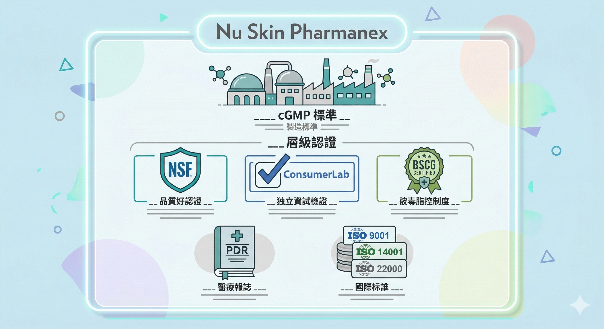
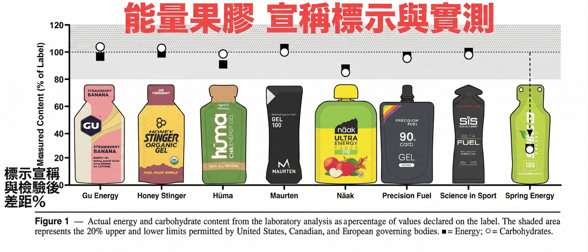

Nu Skin 說他們的營養補充品是以製藥的標準來開發，第一次聽到這句話，很多人的反應是：每家公司都這樣說，不就是老王賣瓜？

但如果你去參觀過他們在中國湖州的大中華創新園區，或是美國猶他州的總部實驗室，聽完工作人員說明之後，你會開始理解為什麼他們敢說這句話。

先揭露：我是 Nu Skin 的經銷商，和這家公司有利益關係。所以這篇我盡量只寫查得到的事實，也會寫出哪些地方「還不算製藥等級」。

這篇先說清楚食品製造標準和製藥製造標準的差距，再逐一對照 Nu Skin 實際達到了哪些具體標準。

---

## 食品 GMP 和製藥 GMP：不是同一件事

很多人以為 GMP 只有一種，事實上保健品業和製藥業的 GMP 標準有很大的差距。

**製藥 GMP 的起源**

美國於1963年率先公布藥品優良製造作業規範（GMP），確保藥品製造過程的品質與安全。

世界衛生組織（WHO）於 1969 年頒布自己的 GMP 版本，英國 1971 年、日本 1974 年、台灣 1982 年陸續跟進。

台灣在 1995 年進一步實施更高標準的cGMP（Current Good Manufacturing Practices，現行藥品生產管理規範），要求製藥設備、製程和分析方法全程確效。

2007 年再升級為 PIC/S GMP（Pharmaceutical Inspection Convention and Co-operation Scheme），與歐盟GMP標準等同，這是目前國際最嚴格的藥品生產管理標準之一，要求從產品開發初期就啟動品管，全面且週期性的環境監控與風險評估。

**食品 GMP 的現實**

台灣的食品製造管理有「食品 GMP」標章（俗稱微笑標章）。

但食品 GMP 的功能並非驗證產品有效性，也非針對保健功效設計，它單純是一種生產管理機制。

2011 年起的塑化劑、食用油、餿水油等食安風波，都有 GMP 認證業者牽涉其中，顯示食品GMP的把關力度有其限制。

後來雖改組為台灣食品優良協會（TQF），但整體標準仍和製藥 GMP 有相當大的距離。

**關鍵差距在哪裡**

保健品在法律上屬於食品，基本上符合食品級規範即可上市，就像市售飲料餅乾一樣。

一家廠商可以完全合法地在食品等級工廠裡生產保健品，然後宣稱「通過 SGS 合格」、「通過 FDA 登記」，完全不需要達到製藥等級的生產標準。

Nu Skin 選擇了另一條路。

---

## Nu Skin 的製造標準：具體認證清單

Nu Skin 的 Pharmanex 營養補充品，已取得以下具體認證：

**湖州保健品生產基地工廠認證歷程：**
- 2005年：通過GMP認證
- 2009年：通過ISO 9001品質管理系統認證
- 2015年：通過ISO 14001環境管理、OHSAS 18001 職業健康安全認證（現已改版為 ISO 45001）
- 2017年：通過ISO 22000食品安全管理系統認證

整個廠區由德國 Pharma Consult 公司設計，廠房佈局、設施與設備符合 GB50073-2001 潔淨廠房規範，人流物流獨立佈局，從源頭避免交叉污染。

要誠實說：上面這些是保健食品 GMP 和國際管理系統（品質、環境、食品安全）的認證，**不等於藥品的 PIC/S GMP**。所以比較精確的說法是：Nu Skin 用「接近製藥的思維」在開發與管理保健品（例如潔淨廠房、原料標準化、臨床試驗），而不是「用藥品等級生產」。

** NSF 認證**

Pharmanex 的 LifePak 通過了 NSF 的配方和毒理學全面審查，NSF 是保健品領域公認嚴格的第三方認證機構之一，它的 GMP 審核有明確的流程與缺失分級。

**三重第三方認證（LifePak）**

2005 年，Pharmanex LifePak 同時取得 NSF、ConsumerLab 及 BSCG 三項第三方認證（來源：Pharmanex 2005 年新聞稿；認證是否持續有效，請以各機構官網查詢為準）：

NSF，配方與毒理學全面審查、cGMP合規  
ConsumerLab，成分獨立驗證，LifePak在六個類別中通過評估  
BSCG，確認不含IOC、WADA、USADA、NFL、NCAA等機構列管的80種以上禁藥

**PDR收錄（醫師桌上參考手冊）**

Pharmanex是少數在PDR（Physician's Desk Reference，醫師桌上參考手冊）中收錄產品的保健品公司，目前有 7 款產品列入，包括ageLOC R2，PDR 不要求 FDA 批准。要知道的是，PDR 裡保健品的資料多半是由廠商提供，收錄代表醫療人員查得到這個產品的資訊，不等於醫學界背書它的效果。

---

## 6S品質流程：製藥思維在保健品的實踐

Pharmanex的核心品管機制是 **6S品質流程**，六個英文 S 代表六個階段：

**Selection（篩選）**：由植物化學家和科學家組成的團隊，從全球文獻和傳統使用記錄中篩選具有健康促進潛力的植物原料，只有通過真實性、有效性和安全性測試的原料才進入下一階段。

**Sourcing（原料來源）**：確認後針對每個原料尋找最優質的供應來源，Nu Skin在中國和智利設有自己的原料種植基地，對每個來源的樣品進行全面的成分分析，依據有效成分濃度選定供應商。

**Structure（結構分析）**：使用先進的分析技術，結合與各大學和實驗室的合作，對選定植物原料的化學結構進行分析，分離並純化標準化萃取物中的特定化學結構，這一步確認了活性成分的分子身份。

**Standardization（標準化）**：透過嚴格的製程標準化，確保每顆膠囊中每個活性成分的含量完全一致。一般保健品原料（尤其是植物萃取）各批次的有效成分濃度可能差異很大，標準化流程解決這個問題。

這不是理論問題，而是已經在補給品市場發生的事。

2024年底，《International Journal of Sport Nutrition and Exercise Metabolism》發表了一項由跑者自費發起的研究，他們覺得某款標榜「全天然、稻米製作」的能量果膠吃起來沒感覺，於是集資送實驗室化驗。

結果出來，該品牌（Spring Energy Awesome Sauce）的誤差遠超業界容許的 ±20%：

- 能量標示 180 大卡，實測 53 大卡
- 碳水標示 45 克，實測 12.5 克
- 鈉含量短少近 80%

原因正是天然食材本身的不確定性，稻米、水果泥的能量密度隨產季水分和烹調方式劇烈波動，在沒有標準化分析流程的情況下，每批次的實際含量根本無法控制。

**天然不等於穩定。標準化，是讓「天然」變得可信賴的那道工序。**

**Safety（安全性）**：收集並審查原料歷史使用記錄和安全數據，確認使用的有效成分濃度基於臨床研究確認有效的劑量，並根據已發表的數據設定安全上限。

**Substantiation（科學佐證）**：Pharmanex只發布有已記錄的臨床前和臨床研究佐證的產品聲明。現有臨床數據會被系統性審查，必要時Pharmanex會贊助並主導自家產品的臨床試驗，研究結果提交至主要國際期刊接受同行評審。

這六個步驟，就是製藥公司開發新藥的邏輯，從分子鑑定到臨床佐證，形成一套完整的科學證據鏈。

---

## LifeGen 技術：配方篩選的科學基礎

Nu Skin 的 ageLOC 產品系列背後，有一個特別的技術基礎。

Nu Skin在 2011 年收購了 LifeGen Technologies，取得了其核心資產，同類中規模最大的抗老化基因表達資料庫，擁有超過30年的基因表達研究積累。

這個資料庫的用途是：通過基因微陣列分析，找出哪些成分組合能讓與老化相關的基因表達模式往年輕方向移動，讓 ageLOC 配方的篩選從「聽說這個成分對XX有用」，升級為「基因表達層面確認有效」。

---

## 怎麼用這篇

說清楚這件事的目的，不是要你閉著眼睛相信 Nu Skin 說的每一句話。

而是：現在你有了一套問問題的框架，配方依據、臨床試驗、生產標準、有效劑量，你可以用同樣的四個問題，去問任何一個你考慮購買的保健品品牌。

能回答這四個問題的品牌，不多。

能用具體數據和獨立第三方認證來回答這四個問題的品牌，更少。

包括 Nu Skin 在內，任何品牌說的「製藥標準」，你都可以拿這四個問題去對照，自己判斷。

---

**延伸閱讀：**
- [廠商那張SGS合格報告和你吃進去有沒有用，是兩件事](/blog/precision-health-tools/sgs-report-vs-efficacy/) 
- [ageLOC Youthspan：可以不節食讓細胞以為你在挨餓，啟動修復基因功能](/blog/intervention-optimization/ageloc-youthspan-longevity-genes/) 
- [ageLOC R2：那個40歲看起來像32歲的男人，細胞在夜裡做了什麼？](/blog/intervention-optimization/ageloc-r2-cellular-renewal/) 

---

## 參考資料

01. [Pharmanex 6S Quality Process](<https://api.nuskin.com/content/dam/office/n_america/shared/en/pharmanex_products/6s_flyer.pdf>). Nu Skin官方製程文件；原連結其實指向LifeGen Acquisition，已更正。未查得 DOI；來源身分已核對（2026-10-19）。
02. [Nu Skin Enterprises 2005 Annual Report Shareholder’s Letter](<https://www.sec.gov/Archives/edgar/data/1021561/000102156106000019/ex99-1.htm>). 公司向SEC提交之2005年度股東信；記載當年三重認證，不能據此聲稱所有現售產品批次仍有認證。未查得 DOI；來源身分已核對（2026-10-19）。
03. [The Prescribers’ Digital Reference (PDR) Claim Policies](<https://www.nuskin.com/content/dam/sea/bn/home_page/regulatory_corner/BN-Compliance-Advisory-PDR-poster.pdf>). Nu Skin官方合規文件；PDR收錄不等於FDA核准或療效認證。未查得 DOI；來源身分已核對（2026-10-19）。
04. [Nu Skin Enterprises Acquires LifeGen Technologies](<https://www.prnewswire.com/news-releases/nu-skin-enterprises-acquires-lifegen-technologies-135569723.html>). Nu Skin原始新聞稿，2011-12-14。未查得 DOI；來源身分已核對（2026-10-19）。
05. Lee Cheol-Koo, Klopp Roger G., Weindruch Richard et al. (1999). Gene Expression Profile of Aging and Its Retardation by Caloric Restriction. *Science*, 285(5432):1390-1393. DOI：[10.1126/science.285.5432.1390](<https://doi.org/10.1126/science.285.5432.1390>)。
06. Mastaloudis Angela, Wood Steven M. (2012). Age‐related changes in cellular protection, purification, and inflammation‐related gene expression: role of dietary phytonutrients. *Annals of the New York Academy of Sciences*, 1259(1):112-120. DOI：[10.1111/j.1749-6632.2012.06610.x](<https://doi.org/10.1111/j.1749-6632.2012.06610.x>)。
07. Tiller Nicholas B., Burke Louise M., Howe Stephanie M. et al. (2025). What’s (Not) in Your Supplement? An Energy and Macronutrient Analysis of Commercially Available Carbohydrate Gels. *International Journal of Sport Nutrition and Exercise Metabolism*, 35(2):162-170. DOI：[10.1123/ijsnem.2024-0174](<https://doi.org/10.1123/ijsnem.2024-0174>)。
08. SupplySide Supplement Journal。Pharmanex Product Passes Certifications（Pharmanex 公司新聞稿轉載）。2005。<https://www.supplysidesj.com/certification/pharmanex-product-passes-certifications>
