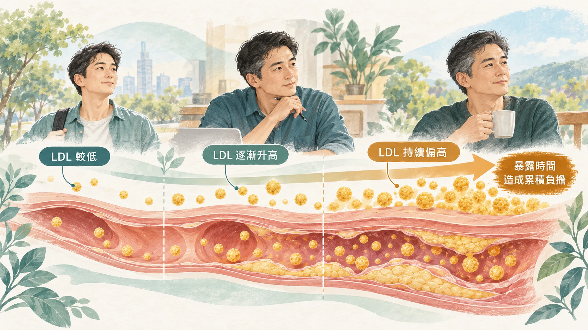
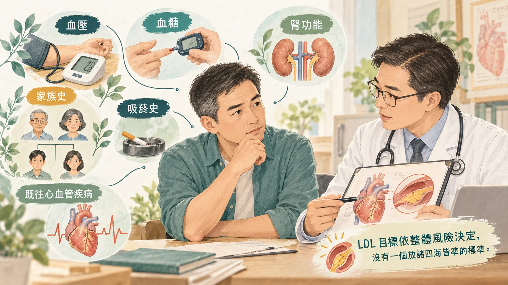

<!-- 🎨 [cover] [類型 A]
畫面：A cardiologist's desk with a stethoscope, a small row of pill bottles, and a printed lipid report with a highlighted blank row, warm office light. Warm off-white, teal and sage, soft editorial illustration, no readable text.
標籤（Canva 填入）：心臟科醫師自己也吃 statin？
STYLE: 依 IMAGE-STYLE.md 第 7.2 節
-->

心臟科醫師自己有沒有在吃降膽固醇藥？

心臟科連思涵醫師拍了一支短影片，跑了台南好幾家醫院和診所，一個一個問同事。

「當然有啊，我桌上就有一排。」
「有啊，一定要的啊。」
「LDL 達標，長期有保護的效果。」
「讓自己變成凍齡老妖。」

也有一位醫師說：「我低密度 70，吃了沒好處啊。」所以他沒吃。

同樣是心臟科醫師，有人吃、有人不吃。這背後的邏輯，剛好可以回答一般人最常問的兩個問題：**LDL 要降到多低？我需不需要吃藥？**

## LDL 是心血管疾病的「原因」之一

LDL 就是報告上的「低密度脂蛋白膽固醇」，常被叫做「壞膽固醇」。

歐洲動脈硬化學會在 2017 年整理了 200 多項研究，包括長期追蹤、基因研究和隨機試驗，結論是：**LDL 會造成動脈硬化**，這已經不是「有關聯」，而是因果關係（Ference et al., 2017）。

這份共識還提到一個重點：傷害的大小，取決於 **LDL 有多高，以及高了多久**。也就是說，LDL 對血管的影響是「累積」的。

這就是為什麼有些心臟科醫師選擇早一點開始、把 LDL 壓得更低：他們每天看到的是累積幾十年之後的結果。

## 降多少，風險少多少

國際降膽固醇試驗研究團隊（CTT）整理了 26 個隨機試驗、超過 16 萬人的資料（CTT Collaboration, 2010）：

- **LDL 每降低 1 mmol/L（大約 39 mg/dL），心肌梗塞、中風等主要心血管事件減少約 22%。**
- 在研究涵蓋的範圍內，**沒有看到一個「降到這裡就沒效了」的下限**。
- 降得越多，好處越多：降 2 到 3 mmol/L，風險大約可以減少 40% 到 50%。

這也呼應影片裡郭綜合醫院李見賢醫師的說法：他吃藥之後，LDL 從 110 降到 61，想提早預防、精益求精。

## 那為什麼有醫師說「我 70，吃了沒好處」？

因為**好處的大小，要看你原本的風險有多高**。

同樣降 22% 的風險，對一個本來十年內發生心肌梗塞機率很高的人，是很大的好處；對一個 LDL 已經很低、沒有其他風險因子的年輕醫師，能減少的絕對風險就很少，吃藥的好處自然有限。

所以台灣的血脂治療指引，是**依照每個人的風險高低，訂不同的 LDL 目標**（Li et al., 2022）。年齡、血壓、血糖、抽菸、腎功能、家族史、有沒有心血管病史，都會影響你的目標值是多少。

**沒有一個數字適合所有人。** 你的 LDL 要降到多低，要由醫師依你的整體風險決定。

LDL 之外，醫師有時還會看 ApoB 和 Lp(a)，可以參考〈[LDL 看起來還好，為什麼醫師還會看 ApoB？](/blog/precision-health-tools/apob-vs-ldl/)〉和〈[家人年輕就心肌梗塞？認識 Lp(a)](/blog/chronic-inflammation/lpa-genetic-risk/)〉。

## 副作用：肌肉痠痛有多常見？

很多人不想吃 statin，是因為聽說「會肌肉痠痛」。

影片裡醫師說副作用「大概 2% 的病人會有」。研究怎麼說？CTT 團隊在 2022 年分析了 23 個雙盲試驗、超過 15 萬人的資料（CTT Collaboration, 2022）：

- 吃 statin 的人，回報肌肉痠痛的比例只比吃安慰劑的人多一點點；多出來的大約是**每 1,000 人每年 11 個**，而且大多發生在吃藥的第一年。
- 吃 statin 的人回報的肌肉痠痛，**超過 90% 其實不是 statin 造成的**，吃安慰劑的人也一樣會痠。

也就是說，真正由 statin 引起的肌肉痠痛，比大家以為的少很多。但少不代表沒有，有不舒服還是要回診說清楚。

**這些情況要回診或就醫：**

- 肌肉痠痛無力持續，影響日常生活：回診，讓醫師評估是否調整藥物或劑量。
- **肌肉痠痛合併茶色尿、嚴重無力：請立即就醫。**
- 定期抽血追蹤時，醫師也會看肝功能和血糖。

## 要不要吃？和醫師討論時可以問的三個問題

1. **以我的狀況，屬於哪一個風險等級？我的 LDL 目標是多少？**
2. **如果先從飲食和運動開始，要多久回來抽血？到時候沒達標怎麼辦？**
3. **吃藥之後，要怎麼追蹤？哪些不舒服要回來？**

statin 是處方藥。要不要吃、吃哪一種、吃多少，都由醫師依你的狀況決定；已經在吃的人，**不要自己停藥或換藥**，有疑問回診討論。

不管吃不吃藥，飲食、運動、戒菸、腰圍管理都是基本功。飲食怎麼開始，可以看〈[吃對了，發炎指數卻不動？](/blog/chronic-inflammation/mediterranean-diet-fasting-hscrp-weight-loss/)〉。

## 什麼時候看醫生、看哪一科

- 健檢 LDL 被標紅字，或家人有人很早（男性 55 歲前、女性 65 歲前）就有心臟病或中風：看**家醫科**或**心臟內科**。
- 同時有血糖、血壓問題：可以看**新陳代謝科**。
- **胸痛、胸悶、呼吸困難、單側手腳無力或說話不清楚：請立即就醫。**

## 帶走一句話

**LDL 的傷害是累積的，所以有些心臟科醫師選擇早一點降。** 但要降到多低、要不要吃藥，看的是你自己的整體風險。

---

## 參考資料

1. Ference BA, et al. Low-density lipoproteins cause atherosclerotic cardiovascular disease. 1. Evidence from genetic, epidemiologic, and clinical studies. A consensus statement from the European Atherosclerosis Society Consensus Panel. *European Heart Journal*, 2017.（來源：[European Heart Journal](https://doi.org/10.1093/eurheartj/ehx144)，2017）
2. Cholesterol Treatment Trialists' (CTT) Collaboration. Efficacy and safety of more intensive lowering of LDL cholesterol: a meta-analysis of data from 170,000 participants in 26 randomised trials. *Lancet*, 2010.（來源：[Lancet](https://doi.org/10.1016/S0140-6736(10)61350-5)，2010）
3. Cholesterol Treatment Trialists' (CTT) Collaboration. Effect of statin therapy on muscle symptoms: an individual participant data meta-analysis of large-scale, randomised, double-blind trials. *Lancet*, 2022.（來源：[Lancet](https://doi.org/10.1016/S0140-6736(22)01545-8)，2022）
4. Li YH, et al. 2022 Taiwan lipid guidelines for primary prevention. *Journal of the Formosan Medical Association*, 2022.（PMID：[35715290](https://pubmed.ncbi.nlm.nih.gov/35715290/)）
5. 連思涵醫師。POV：心臟科醫師有沒有吃膽固醇藥？Facebook 短影片。https://www.facebook.com/share/r/1FdWdanRAH/（醫師個人說法，作為開場情境，非科學證據）

*本文為健康教育資訊，不構成醫療診斷或治療建議。*
