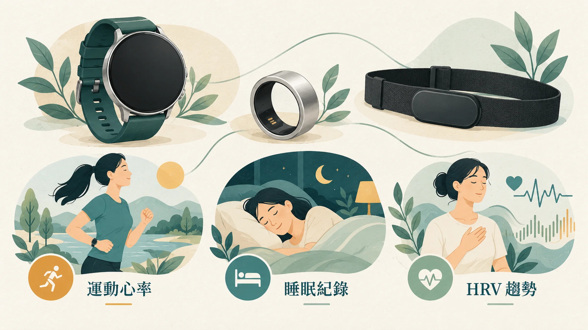
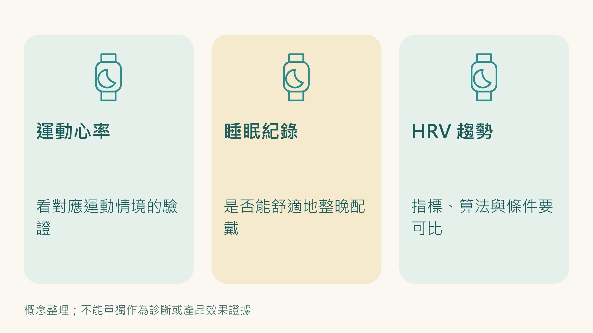
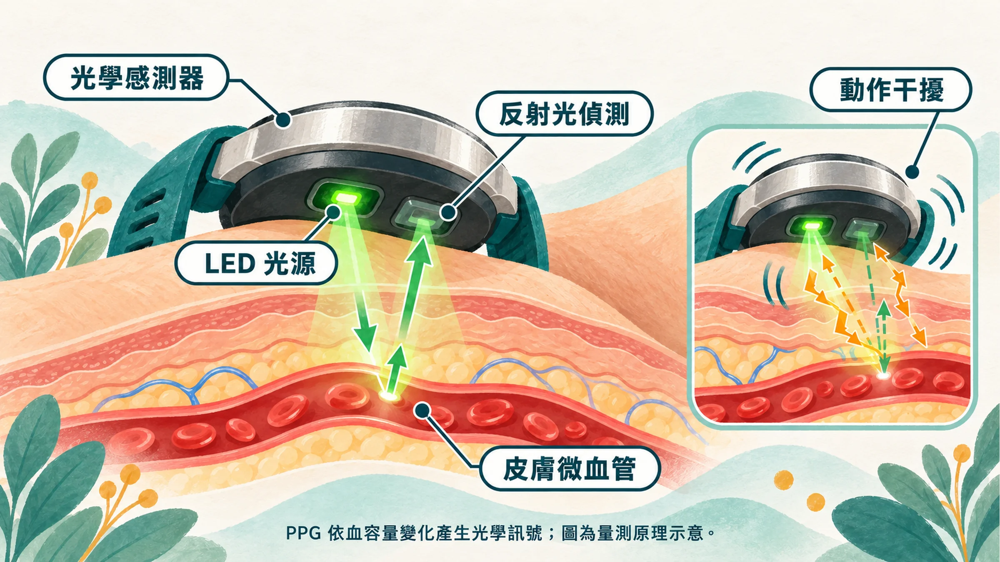

買了很貴的手錶，卻每天晚上拿去充電。

白天的步數一筆不少，真正想看的睡眠資料，反而整晚空白。

所以選手錶還是戒指，第一題先問用途：你最想知道的是運動心率、睡眠作息，還是 HRV 趨勢？

## 先決定要回答哪一題

| 你最在意的問題 | 選購時先確認 |
|---|---|
| 運動時心率變化 | 相關運動情境的驗證、是否能搭配胸帶 |
| 幾點睡、幾點起床 | 夜間配戴舒適度、續航、睡眠紀錄缺漏 |
| 夜間 HRV 趨勢 | 用什麼指標、取樣方式、是否有相應研究 |
| 通知、支付等日常功能 | 使用習慣與充電安排，能否兼顧想量的時段 |

再好的感測器，沒戴著時都不會留下資料。先選能持續使用的工具，才有後面的比較。

## 它用光看脈搏，不是直接量心臟電訊號

許多手錶、手環與戒指使用 PPG，也就是用光偵測皮膚下血流的變化。運動晃動、接觸情況和演算法，都可能影響估計結果。運動研究中，不同裝置在不同強度下的誤差不一樣。[1]

## 看研究，要連型號和使用情境一起看

### 運動心率：胸帶是值得比較的選項

2017 年的研究以心電圖為標準，比較當時多款裝置，胸帶表現較好，手腕裝置則受運動種類與強度影響。這支持在重視運動心率時考慮胸帶，但不能直接宣稱所有胸帶都勝過所有新款手錶。[1]

### 夜間 HRV：一份研究，不是永久排行榜

2025 年《Physiological Reports》研究收集 13 位健康成人、536 個夜晚的資料，將指定裝置與心電圖比較。夜間 HRV 的一致性係數 CCC 如下：[2]

| 受測裝置 | CCC |
|---|---|
| Oura 第 4 代 | 0.99 |
| Oura 第 3 代 | 0.97 |
| WHOOP 4.0 | 0.94 |
| Garmin Fenix 6 | 0.87 |
| Polar Grit X Pro | 0.82 |

CCC 越接近 1，代表這份資料中的一致性越高；**0.99 不等於「所有情況準確率 99%」**。結果限於受試族群、當時型號、演算法與研究條件，不能直接外推到所有人或整個品牌。[2]

這項研究沒有提供 Apple Watch 的同一套夜間 HRV 比較。Apple HealthKit 的 HRV 型別是 SDNN，也不能把它直接放進 RMSSD 排名。[3]

WHOOP 相關研究者另對比較情境提出討論，購買前值得連研究限制一起看。[4]

### 睡眠分期：看趨勢，別把分鐘數當診斷

2021 年研究比較七款當時的消費型裝置與多項睡眠檢查，對睡眠／清醒與各睡眠分期的辨識表現不同。當時的結果不能保證目前每個型號都有相同表現。[5]

如果你在意的是打鼾、呼吸中止或白天嗜睡，裝置資料可以拿去討論，但不能代替睡眠門診與必要檢查。

## 購買前，做完這四個確認

1. **用途符合**：找的是你要量的項目，而不只是品牌總分。
2. **情境符合**：研究是在睡眠、靜止，還是你常做的運動？
3. **能長期戴**：舒適、充電、訂閱費與資料匯出，都要算進去。
4. **數字可比較**：同一指標、同一方法看自己的趨勢；換裝置時另立比較起點。

如果現有工具已經能回答你的問題，不必為了排名換一整套。

**能回答你的問題、也能持續戴著的，才是適合你的工具。**

想先學怎麼讀數字，接著看 [HRV 的四個閱讀原則](/blog/precision-health-tools/hrv-recovery-guide/)；買好以後怎麼留紀錄，則看 [做一份能持續的身體追蹤表](/blog/intervention-optimization/tracking-rhythm/)。

*本文供健康教育與工具比較使用，不以消費型裝置診斷疾病；研究結果需配合受測版本與情境解讀。*

## 參考文獻

1. Gillinov S, et al. Variable accuracy of wearable heart rate monitors during aerobic exercise. *Med Sci Sports Exerc*. 2017;49:1697–1703. https://doi.org/10.1249/MSS.0000000000001284
2. Dial MB, et al. Validation of nocturnal resting heart rate and heart rate variability in consumer wearables. *Physiol Rep*. 2025;13:e70527. https://doi.org/10.14814/phy2.70527
3. Apple Developer Documentation. heartRateVariabilitySDNN. https://developer.apple.com/documentation/healthkit/hkquantitytypeidentifier/heartratevariabilitysdnn
4. WHOOP, Inc. Accurate comparison of wearables requires contextual equivalence (Letter). *Physiol Rep*. 2025. https://doi.org/10.14814/phy2.70710
5. Chinoy ED, et al. Performance of seven consumer sleep-tracking devices compared with polysomnography. *Sleep*. 2021;44:zsaa291. https://doi.org/10.1093/sleep/zsaa291
