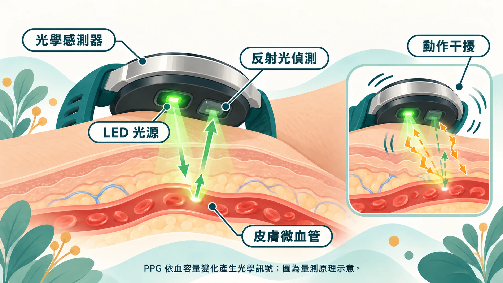
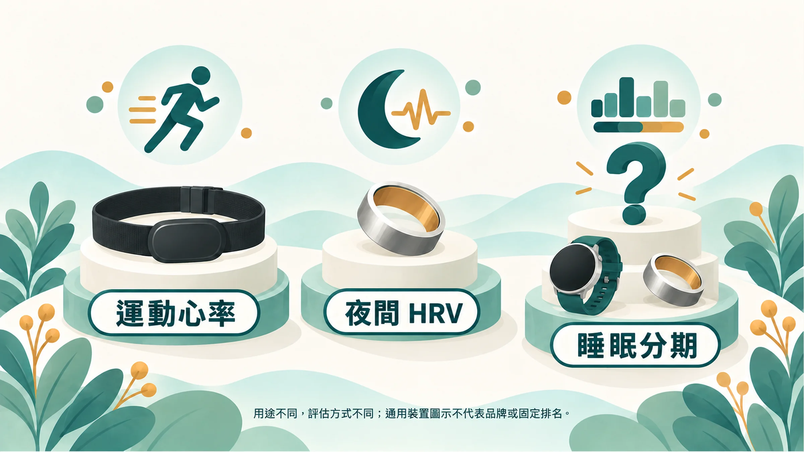

「到底哪一支手錶最準？」

這是我最常被問的問題之一。每次我都會反問：「你想拿它量什麼？」

因為量跑步時的心率、量半夜的 HRV、量你昨晚睡了幾分鐘深睡，排名完全不一樣。

## 光學感測的先天限制

大多數手錶、戒指、手環，都是用綠光或紅外光照進皮膚，偵測血管裡血流的變化，推算心跳。這種技術叫光體積變化描記（PPG），也就是說，用光「看」脈搏，不是直接量心臟的電訊號。

這讓它有幾個天生的弱點：

- **劇烈晃動時容易失準**：跑步、重訓、打球時，手腕動來動去，訊號會被干擾[1]。
- **演算法是黑盒子**：同樣的原始訊號，不同品牌用不同演算法計算，結果就不同。
- **取樣率會讓 HRV 偏高**：光學感測每秒取樣的次數有限，找心跳波峰時會有時間誤差。這個誤差對心率幾乎沒影響，卻會讓 RMSSD 被高估，而且本身 HRV 越低的人，被高估的比例越大[7]。韌體更新後數字突然整體跳動，也可能是算法改了，不一定是身體變了[7]。
- **晚上才是它的主場**：睡覺時身體靜止，光學感測反而最穩定，這也是夜間 HRV 和靜息心率比較可靠的原因。

## 你想看什麼，決定你該選什麼

很多人買了最貴的手錶，結果每天晚上拿去充電，最該量的睡眠資料反而一片空白。

選裝置之前，先問自己三個問題：

1. 我最在意的是**運動表現**、**夜間恢復**，還是**睡眠品質**？
2. 我願意**晚上戴著睡覺**嗎？手腕會不會不舒服？
3. 我多久願意**充一次電**？

## 驗證研究怎麼說

### 運動心率：胸帶最準

一項比較多款手腕裝置和胸帶的研究，以心電圖為標準，發現胸帶在運動中的準確度最高，手腕式裝置在高強度運動時誤差明顯變大[1]。如果你很在意間歇訓練或心率區間，胸帶仍然是首選。

### 夜間 HRV 與靜息心率：戒指表現最好

2025 年《Physiological Reports》的研究，讓 13 位健康成人同時配戴心電圖和多款裝置睡覺，累計 536 個夜晚[2]：

| 裝置 | 夜間 HRV 與心電圖的一致性（CCC，越接近 1 越好） |
|---|---|
| Oura 第 4 代 | 0.99 |
| Oura 第 3 代 | 0.97 |
| WHOOP 4.0 | 0.94 |
| Garmin Fenix 6 | 0.87 |
| Polar Grit X Pro | 0.82 |

這個研究**沒有納入 Apple Watch**。原因是 Apple Watch 記錄的 HRV 是背景零星量測的 SDNN[3]，不是一個整夜的 RMSSD 數值，無法直接比較。

### 同樣叫「夜間 HRV」，各家算法不一樣

| 品牌 | 一晚的 HRV 怎麼算出來（依各家公開說明整理）[6] |
|---|---|
| Oura | 整夜每 5 分鐘一筆 RMSSD，取平均 |
| Garmin | 整段睡眠每 5 分鐘一段，取平均 |
| Polar | 入睡後約前 4 小時的 RMSSD |
| WHOOP | 加權平均，偏重最後一段深層睡眠 |
| Fitbit | 前 24 小時內最長一段（3 小時以上）睡眠的 RMSSD |
| Apple | SDNN，背景零星量測，不是單一整夜數值 |

這也是為什麼**換裝置就等於換尺**：數字的定義不同，前後無法放在同一條趨勢線上。

要注意的是，這項研究的人數不多、受試者都是健康成人，而且 WHOOP 的研究團隊對比較方法提出了不同看法[4]。裝置和演算法也一直在更新，任何排名都只代表當時的版本。

### 睡眠分期：分睡醒還行，分深淺還差一截

2021 年一項研究比較 7 款消費型睡眠裝置和多項睡眠檢查（PSG），發現多數裝置判斷「睡著或醒著」的表現不錯，但區分淺睡、深睡、快速動眼期的準確度明顯較差[5]。

所以手錶說你昨晚深睡 1 小時 17 分，看看就好；**連續幾週的變化方向**，比單晚的分鐘數更有參考價值。

## 依需求的選擇建議

| 你最在意的 | 建議 |
|---|---|
| 夜間恢復、HRV 趨勢 | 戒指型或手環型，戴著睡覺不打擾；選一款長期戴，看自己的趨勢 |
| 運動心率、訓練區間 | 胸帶搭配手錶 |
| 想要最準的 HRV 趨勢 | 胸帶式心電感測器，每天起床後固定姿勢量 1～5 分鐘[8] |
| 生活全方位（通知、支付、運動、睡眠） | 智慧手錶，但要調整充電時間，避開睡眠 |
| 預算有限、只想開始 | 任何一款你**願意天天戴著睡覺**的裝置 |

**最重要的一條**：比起選到「最準」的那一款，**長期戴同一款**更重要。換裝置等於換尺，前後數字就沒辦法比了。

想了解手錶能量什麼、量不到什麼，請看 [Apple Watch 量得到睡眠，量不到根本原因](/blog/precision-health-tools/apple-watch-sleep-vs-root-cause/)；HRV 數字怎麼讀，請看 [HRV：今天，修好了嗎？](/blog/precision-health-tools/hrv-recovery-guide/)

## 手錶量恢復，Prysm iO 量防禦

穿戴裝置能告訴你身體每天修得好不好，但看不到你的抗氧化防禦網剩下多少。皮膚類胡蘿蔔素量測，剛好補上這一塊。不同抗氧化檢測工具的比較，可以參考 [抗氧化掃描儀怎麼比](/blog/precision-health-tools/antioxidant-scanner-comparison/)。

**延伸閱讀**
- [三個數字一起看：6 種常見組合](/blog/precision-health-tools/three-clues-cross-reading/)
- [每日、每月、每年：個人化的身體追蹤節奏](/blog/intervention-optimization/tracking-rhythm/)

---

*本文為健康教育與趨勢追蹤用途，不等同醫療診斷，也未接受任何裝置品牌贊助。裝置與演算法持續更新，請以最新驗證研究為準。*

## 參考文獻

1. Gillinov S, et al. Variable accuracy of wearable heart rate monitors during aerobic exercise. *Med Sci Sports Exerc*. 2017;49:1697–1703. https://doi.org/10.1249/MSS.0000000000001284
2. Dial MB, et al. Validation of nocturnal resting heart rate and heart rate variability in consumer wearables. *Physiol Rep*. 2025;13:e70527. https://doi.org/10.14814/phy2.70527
3. Apple Developer Documentation. heartRateVariabilitySDNN. https://developer.apple.com/documentation/healthkit/hkquantitytypeidentifier/heartratevariabilitysdnn
4. WHOOP, Inc. Accurate comparison of wearables requires contextual equivalence (Letter). *Physiol Rep*. 2025. https://doi.org/10.14814/phy2.70710
5. Chinoy ED, et al. Performance of seven consumer sleep-tracking devices compared with polysomnography. *Sleep*. 2021;44:zsaa291. https://doi.org/10.1093/sleep/zsaa291
6. sleepbug. Day 05｜每晚一個 HRV 數字是怎麼來的？從 5 分鐘視窗到 nightly metric。iThome 鐵人賽《30 天拆解 Wearable × AI》（整理各廠商公開文件，非同儕審查）。https://ithelp.ithome.com.tw/articles/10413409
7. sleepbug. Day 06｜Sampling Rate：取樣頻率為何決定你能相信什麼？iThome 鐵人賽《30 天拆解 Wearable × AI》（技術部落格，非同儕審查）。https://ithelp.ithome.com.tw/articles/10413824
8. Shaffer F, Ginsberg JP. An overview of heart rate variability metrics and norms. *Front Public Health*. 2017;5:258. https://doi.org/10.3389/fpubh.2017.00258
