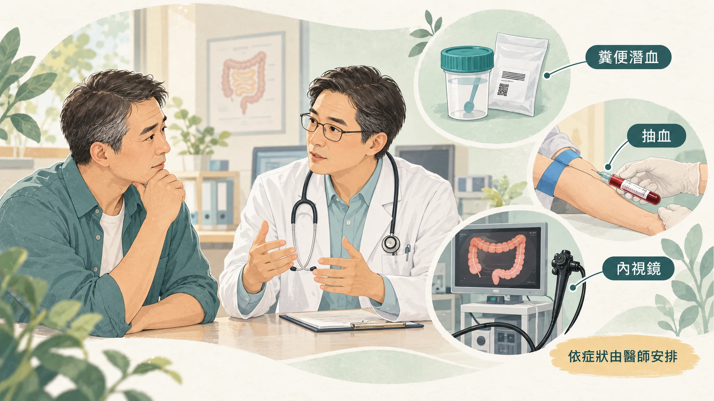
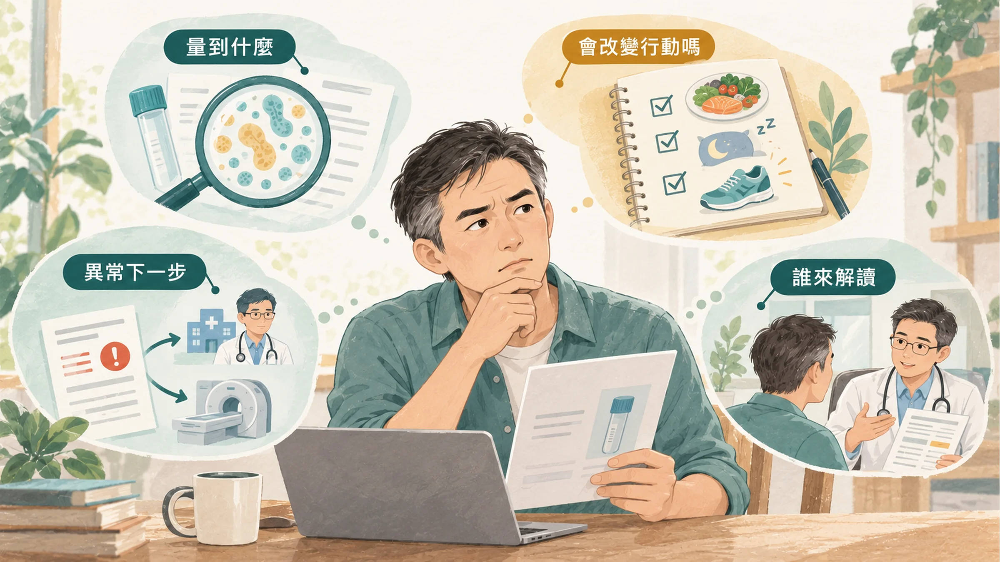

<!-- 🎨 [cover] [類型 A]
畫面：A blood test tube with an amber sample next to a printed lab report with blank rows and a large question mark, on a warm off-white desk. Teal and sage palette, soft editorial illustration, no readable text.
標籤（Canva 填入）：腸漏症檢測準不準？
STYLE: 依 IMAGE-STYLE.md 第 7.2 節
-->

前兩篇講到：腸道真的會變漏（〈[腸漏症是真的嗎？](/blog/body-signals/leaky-gut-what-is-real/)〉），而且耐力運動、止痛藥、喝酒和加工食品都可能有影響（〈[哪些習慣會讓腸道變漏？](/blog/chronic-inflammation/gut-barrier-habits-exercise-nsaids-alcohol/)〉）。

接著一定有人想問：那我要怎麼知道自己有沒有腸漏？

上網搜尋，會看到很多自費檢測：「抽一管血驗 zonulin，就知道腸道屏障好不好」，價格從幾千到上萬元都有。

花錢之前，先看研究怎麼說。

## zonulin 是什麼

**zonulin** 是一種蛋白質，研究認為它會讓腸道細胞之間的緊密連接（也就是把相鄰細胞綁在一起的拉鍊）打開。它被認為和乳糜瀉這類疾病有關，所以有人想用它當作「腸道漏不漏」的指標。

想法很合理。問題出在：**你驗到的，真的是 zonulin 嗎？**

## 研究發現：市售試劑量到的，可能不是 zonulin

**第一個研究：** 德國與美國的團隊（包括最早研究 zonulin 的 Fasano 實驗室）檢驗了一款被廣泛使用的市售 zonulin 試劑。他們發現，這款試劑對真正的 zonulin（前結合球蛋白 2，pre-haptoglobin 2）幾乎沒有反應；它抓到的，比較像是另一種叫 properdin 的蛋白質，或結構相似的一群蛋白質（Scheffler et al., 2018）。

研究也發現，這個試劑的數字在肥胖和第二型糖尿病的人身上比較高，而且和三酸甘油酯、空腹血糖一起變動。也就是說，數字高，可能反映的是代謝狀態，不一定是腸道。

**第二個研究：** 澳洲團隊測試了兩款市售試劑。兩款都測不到真正的 zonulin，而且它們抓到的是不同的蛋白質；同一批血液樣本，兩款試劑的結果幾乎對不起來（Ajamian et al., 2019）。

作者的結論很直接：在弄清楚這些試劑到底在量什麼之前，用血中 zonulin 來評估腸道屏障，**沒有意義**。

這不代表 zonulin 這個蛋白質不重要，而是**目前市面上的檢測工具，還沒辦法可靠地量到它**。

## 另一個常被一起推薦的：食物 IgG 檢測

有些「腸漏套組」會加上食物 IgG 檢測，列出一長串「你對這些食物敏感」，建議你通通不要吃。

歐洲過敏與臨床免疫學會（EAACI）的工作小組針對這類檢測發表過立場：血中對食物的 IgG4 抗體，反映的是**你吃過這些食物**，身體正常地認得它們，不代表過敏或不耐；這類檢測**不建議**用來診斷食物過敏或不耐（Stapel et al., 2008）。

最常見的結果，是報告上列出的「敏感食物」，剛好就是你最常吃的東西。照著全部忌口，反而可能吃得不均衡。

## 研究裡怎麼量腸道通透性

研究裡比較常用的方法，是讓人喝下幾種身體不太吸收的糖（例如乳果糖和甘露醇），再收集尿液，看有多少糖「漏」進身體（Camilleri, 2019）。

這個方法比較直接，但需要固定流程、收集好幾個小時的尿液，結果也會受飲食、運動、藥物影響，所以主要用在研究，不是一般健檢會做的項目。

## 肚子有狀況，真正有用的檢查是哪些

如果你是因為腸胃不舒服才想做檢測，與其先驗 zonulin，不如讓**腸胃科**醫師依照你的症狀安排。常見的方向包括：

- **糞便潛血檢查：** 國民健康署提供 45 到 74 歲民眾每兩年一次免費篩檢；父母、子女或兄弟姊妹曾罹患大腸癌的人，40 歲起就可以做。結果異常的話，建議安排大腸鏡（衛生福利部，2025）。
- **抽血：** 看有沒有貧血、發炎指數、肝功能、甲狀腺。
- **大腸鏡或胃鏡：** 由醫師依症狀和年齡判斷需不需要。

這些檢查不會告訴你「漏不漏」，但能排除真正需要處理的問題。

## 花錢做自費檢測之前，先問這四件事

不只是腸漏檢測，任何自費檢測都可以先問：

1. **它量的是什麼？** 試劑有沒有被獨立研究驗證過，真的量到它宣稱的東西？
2. **結果會改變我要做的事嗎？** 如果不管結果高低，你都會做一樣的事（吃好、睡好、少喝酒），那這個檢測就沒有加分。
3. **異常的話，下一步是什麼？** 是轉介醫師做進一步檢查，還是直接推薦一套產品？
4. **誰在解讀？** 報告是由醫師和你一起看，還是只有一張分數表？

健檢報告上哪些數字比較值得花時間看，可以參考〈[健檢沒紅字，還要看什麼？](/blog/body-signals/checkup-five-numbers/)〉。

## 什麼時候看醫生、看哪一科

- 血便、黑便、體重莫名下降、排便習慣改變超過幾週、半夜被肚子痛醒：看**腸胃科**。
- 吃了某種食物後嘴唇腫、起疹子、呼吸困難：這是過敏的急症，請立即就醫；之後看**過敏免疫科**，用正規的方法確認過敏原。
- 已經做了自費檢測，報告讓你很擔心：帶著報告看**家醫科**或**腸胃科**，不要自己照著報告大幅忌口。

拿到一張檢驗報告，先問它量的是什麼、結果會不會改變接下來的處理。肚子持續不舒服，或有血便、體重下降等警訊，先看腸胃科；不用急著替自己買一個「腸漏症」的答案。

下一篇〈[益生菌能修腸道屏障嗎？](/blog/intervention-optimization/probiotics-gut-barrier-evidence/)〉，來看哪些菌株做過人體研究，以及還沒證實的部分。

---

## 參考資料
1. Scheffler L, et al. Widely used commercial ELISA does not detect precursor of haptoglobin2, but recognizes properdin as a potential second member of the zonulin family. *Frontiers in Endocrinology*, 2018. DOI：[10.3389/fendo.2018.00022](https://doi.org/10.3389/fendo.2018.00022)。
2. Ajamian M, et al. Serum zonulin as a marker of intestinal mucosal barrier function: may not be what it seems. *PLoS ONE*, 2019. DOI：[10.1371/journal.pone.0210728](https://doi.org/10.1371/journal.pone.0210728)。
3. Stapel SO, et al. Testing for IgG4 against foods is not recommended as a diagnostic tool: EAACI Task Force Report. *Allergy*, 2008. DOI：[10.1111/j.1398-9995.2008.01705.x](https://doi.org/10.1111/j.1398-9995.2008.01705.x)。
4. Camilleri M. Leaky gut: mechanisms, measurement and clinical implications in humans. *Gut*, 2019. DOI：[10.1136/gutjnl-2019-318427](https://doi.org/10.1136/gutjnl-2019-318427)。
5. 衛生福利部。健康台灣－擴展腸癌防護網 「腸」常篩檢護健康。衛生福利部，2025。https://mohw.gov.tw/cp-16-81256-1.html

*本文為健康教育資訊，不構成醫療診斷或治療建議。*