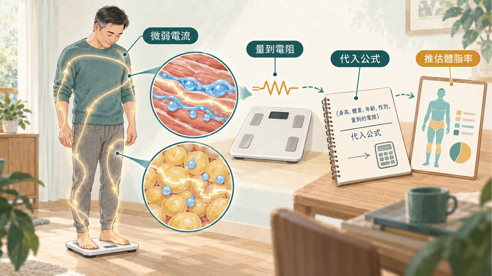
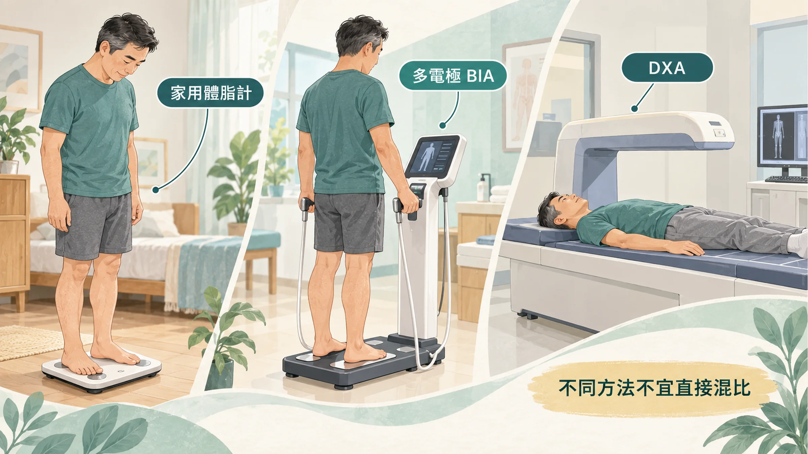

<!-- 🎨 [cover] [類型 A]
畫面：Three body-composition tools arranged side by side on a warm off-white background: a home bathroom body-fat scale, a professional standing analyzer with hand grips, and a hospital DXA scanning table. Clean flat illustration, teal and sage palette.
標籤（Canva 填入）：體脂計準不準？
STYLE: 依 IMAGE-STYLE.md 第 7.2 節
-->

拿來確認胖不胖的指標很多，身體質量指數（BMI）只是其中之一。

BMI 有多不準？廣告上最常出現的例子是「林書豪 VS 連勝文」。一個是 NBA 球員，一個是政治人物，放在一起看，你就知道光靠 BMI 說不清楚誰比較胖。

這就是 BMI 的盲點：它只看身高和體重，分不出那些重量是肌肉還是脂肪。所以很多人改量體脂。

很多廣告告訴你吃這個可以瘦幾公斤。先撇開產品有沒有效，**只量體重、不量體脂和腰圍，數字都是假的**，掉的可能是水分和肌肉，不一定是脂肪。

問題是，家裡的體脂計、健身房的 InBody、醫院的 DXA，量出來常常不一樣。到底該信哪一個？

## 家用體脂計怎麼量：靠電阻「推算」

大部分體脂計用的是**生物電阻分析**（BIA，也就是讓一股很微弱、感覺不到的電流通過身體，量它遇到的阻力）。

原理是這樣：肌肉含水多，電流好通過；脂肪含水少，阻力比較大。量到的阻力越大，代表脂肪可能越多。

但是機器量到的只有「阻力」，體脂率是代進公式算出來的。公式由廠商用一大群受試者的資料建立，再依你輸入的身高、體重、年齡、性別去推算。

所以體脂計的數字是「估計值」，不是直接量到的脂肪重量。

## 誤差從哪裡來

**第一，身體的水分會變。** 電阻量的其實是水，所以喝水、吃飯、流汗、運動、喝酒，都會讓同一天的數字跳來跳去。歐洲臨床營養學會的建議是：要比較的話，盡量固定在空腹、排尿後、運動前量（Kyle et al., 2004）。

**第二，公式的假設不一定適合你。** 很多公式假設「去掉脂肪後的身體，大約 73% 是水」（Wang et al., 1999）。體型偏胖的人，這個比例常常比較高，代進同一個公式就容易算偏。

**第三，電流走的路徑有限。** 只踩兩個腳板的體脂計，電流主要走下半身，上半身靠推算；手腳都要握的機型，會分段量軀幹和四肢，通常比較接近實際。

## InBody 這類專業機器：比較穩定，但還是推算

健身房和診所常見的 InBody，屬於多頻率、分段量測的 BIA，會用好幾種頻率的電流，分別量手、腳和軀幹。

研究比較了幾款 InBody 和醫院的 DXA：同一台 InBody 重複量很穩定；但和 DXA 比，每個人的體脂數字仍可能差好幾個百分點（McLester et al., 2020）。

也就是說，InBody 很適合拿來**追蹤自己的變化**，但不要把某一次的數字當成絕對值，更不要拿不同機器、不同場地量的數字互相比較。

## DXA：目前最常用的參考標準

醫院和部分健檢中心有一種**雙能量 X 光吸收儀**（DXA，也就是常拿來量骨質密度的那台機器）。它用兩種能量很低的 X 光掃過全身，依骨頭、肌肉、脂肪吸收 X 光的程度不同，算出各部位的脂肪和肌肉。

DXA 是研究裡最常用來當參考的方法，輻射量很低，但需要到醫療院所、自費，不適合天天量。如果你想知道自己「真正的起點」，可以考慮做一次 DXA，之後再用 InBody 或體脂計追蹤趨勢。

## 怎麼量，才比得出自己的變化

比起找到「最準的那台機器」，更重要的是**每次用同一台、同一個條件量**：

1. **固定時間：** 早上起床、上完廁所、還沒吃東西也還沒運動的時候。
2. **固定機器：** 家裡的就用家裡那台；InBody 就固定在同一個地方量。
3. **看趨勢，不看單次：** 兩三週比一次，看方向，不要為一天的跳動緊張。
4. **一定要加上腰圍：** 一條皮尺就能量，誤差最小。國民健康署的代謝症候群判定標準，男性腰圍是 90 公分以上。腰圍反映的是肚子裡的脂肪，和代謝風險的關係最直接；為什麼它比體重更值得盯，可以看〈[腰圍每年多三公分，不是你吃太多](/blog/body-signals/visceral-fat-metabolic-signal/)〉。

腰圍量法：站直、放鬆、正常吐氣，皮尺水平繞過肚臍上緣，不要勒緊。

## 數字之外，什麼時候要看醫師

- 體重在沒有刻意減重的情況下，半年內明顯下降。
- 腰圍持續變大，同時健檢的血壓、血糖或血脂被標示紅字：找**家醫科**或**新陳代謝科**一起看。
- 想用藥物協助減重（例如 GLP-1 類藥物）：要由醫師評估，相關注意事項可以看〈[打瘦瘦針前你應該先搞清楚這些事](/blog/intervention-optimization/glp1-clinical-guide-tirzepatide/)〉。

## 帶走一句話

**體脂計量的是趨勢，不是真相。** 同一台機器、同一個時間、再加一條皮尺，你的身材變化才比得出來。

---

## 參考資料

1. Kyle UG, et al. Bioelectrical impedance analysis—part II: utilization in clinical practice. *Clinical Nutrition*, 2004.（PMID：[15556267](https://pubmed.ncbi.nlm.nih.gov/15556267/)）
2. Wang Z, et al. Hydration of fat-free body mass: review and critique of a classic body-composition constant. *American Journal of Clinical Nutrition*, 1999.（來源：[American Journal of Clinical Nutrition](https://doi.org/10.1093/ajcn/69.5.833)，1999）
3. McLester CN, et al. Reliability and agreement of various InBody body composition analyzers as compared to dual-energy X-ray absorptiometry in healthy men and women. *Journal of Clinical Densitometry*, 2020.（PMID：[30472111](https://pubmed.ncbi.nlm.nih.gov/30472111/)）
4. 衛生福利部國民健康署。代謝症候群判定標準。國民健康署，2026。https://www.hpa.gov.tw/

*本文為健康教育資訊，不構成醫療診斷或治療建議。*
